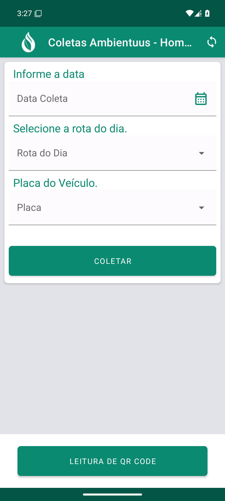

# Original Source Snapshot — Extraction and Build Clone

**Date:** 2026-11-17
**Input:** `APKFiles/OriginalApp/app_coleta_ambientuus_hom_1.59 2.apk` (54,720,633 bytes, SHA-256 `94e4d8a5…c1f5`)
**Output:** frozen tree `original-source/` + reproducible rebuild `build/dist/app_coleta_ambientuus_rebuilt.apk`
**Status:** ✅ extraction complete, ✅ rebuild successful, ✅ installed and launched, ✅ UI pixel-identical

---

## 1. Why this was done before Phase 0

Phase 0 fixes (release build, HTTPS, API credential) will modify the app. Once that starts, the only
record of what was actually shipped disappears. Freezing a buildable copy first gives the client:

- a permanent, auditable baseline of the code they paid for;
- a way to ship emergency patches even without the original project;
- proof that the APK is reconstructible, which de-risks the replacement project;
- a reference to diff future builds against.

## 2. Pipeline

```
APK (read-only)
 ├─ apktool 2.11.1 d ─────────────► original-source/apk/   (smali ×17, res, assets, lib, manifest)
 ├─ jadx 1.5.1 -d --no-res ──────► original-source/java/   (11,284 readable .java files)
 │
 ├─ apktool b (from staged copy) ─► rebuilt-unsigned.apk
 ├─ zipalign -P 16 ──────────────► rebuilt-aligned.apk
 └─ apksigner (v1+v2+v3) ────────► app_coleta_ambientuus_rebuilt.apk
                                     │
                                     ├─ aapt2 badging vs original
                                     ├─ dexdump class/method/field counts vs original
                                     ├─ apktool re-decode → smali hash diff
                                     └─ emulator install + launch + screenshot diff
```

## 3. Results

| Check | Original | Rebuilt | Verdict |
|---|---|---|---|
| Package / version | `com.coleta.ambientuus.debug` / 59 (1.59-DEBUG) | same | ✅ |
| minSdk / targetSdk | 23 / 35 | 23 / 35 | ✅ |
| Permissions, label, launcher | 12 permissions, "Coletas Ambientuus - Homologação" | same | ✅ |
| Badging lines | 130 | 130 | ✅ identical |
| DEX files | 17 | 17 | ✅ |
| Classes (dexdump) | 21,674 | 21,674 | ✅ |
| Methods | 171,219 | 171,219 | ✅ |
| Fields | 77,064 | 77,064 | ✅ |
| ZIP entries | 1,167 | 1,167 | ✅ |
| Smali byte-identical | — | 21,661 / 21,674 | ✅ |
| Runtime | launches | launches | ✅ |
| Screenshot diff | — | 0 px below status bar | ✅ |

Fidelity gaps, all characterized:

- **13 smali files** differ only by explicit `= false` static-field initialisers (the assembler omits a value equal to the DEX default). No behavioural change.
- **19 strings** are lost: D8/R8 metadata blobs (`~~D8{…}`, `~~L8{…}`, `~~~{…}`) embedded by the original compiler. Useful as a build fingerprint, not executable content.
- **256 resource paths** changed because aapt2 drops version qualifiers that are redundant at minSdk 23 (`res/color-v23` → `res/color`). Resource IDs and values are unchanged; on API 23+ resolution is identical.
- **Signature** is new (reference key). The client key is unavailable; the rebuild cannot update an installed original.

## 4. Runtime proof

Emulator: Pixel 6 profile, Android 15 (API 35), `google_apis/x86_64`, headless.
Note: the rebuilt-APK launch had emulator networking enabled, so the app may have issued its normal
read-only startup requests to the homolog endpoint; the original-APK baseline run was performed in
airplane mode. No request was driven or inspected for this report.

1. Install rebuilt → `Success`
2. Launch `MainActivity` → `Status: ok`, `LaunchState: COLD`, process alive, activity resumed
3. Screenshot → [rebuilt](../../build/screens/rebuilt-main.png)
4. Uninstall, install original, launch, screenshot → [original](../../build/screens/original-main.png)
5. Pixel comparison below the status bar (excluding the clock): **0 differing pixels of 2,462,400**



The screen is the real app UI: date picker, route/plate spinners, "COLETAR" button and QR-code reader,
rendered from the reconstructed resources and bytecode.

## 5. Reproduce

```powershell
powershell -ExecutionPolicy Bypass -File build\build-rebuilt.ps1
powershell -ExecutionPolicy Bypass -File build\verify-rebuilt.ps1 -Deep
```

Requirements: JDK 21, Android build-tools 35.0.0, apktool 2.11.1 (paths are parameters of the script).

## 6. What this does not solve

The rebuild is still the **insecure debug app**: debuggable, cleartext HTTP, no API authentication,
hardcoded admin password. It is a preservation and delivery artifact, not a remediation. The security
findings and Phase 0 steps in [the assessment](../analysis/APK-SECURITY-ASSESSMENT.md) still apply,
and any emergency patch built from this snapshot inherits them unless the specific fix is applied.

## 7. Decision log

| Decision | Rationale |
|---|---|
| Freeze smali, not just Java | Only smali is a lossless, rebuildable representation |
| Keep JADX Java too | Humans and future maintainers need readable code; it is labelled approximate |
| Build with apktool, not Gradle | No original project, dependency list, or resource pipeline exists; apktool reproduces the artifact exactly enough to install and run |
| Reference signing key in-repo | Makes rebuild reproducible; clearly labelled non-distribution |
| Stage a copy before building | Keeps `original-source/` immutable |
| Verify at runtime, not only statically | Badging and DEX counts can pass while a resource or signature breaks launch |
